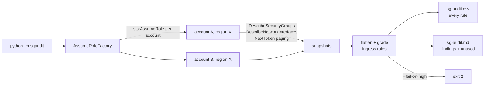

# Security group audit across AWS accounts

A read-only Python script that assumes a role in each AWS account, reads
every security group in the regions you choose, writes a CSV of **every**
ingress rule (the documentation part), and a Markdown report that
highlights rules open to `0.0.0.0/0` or `::/0` and groups nothing uses.

> **Status:** AWS security groups are implemented and unit tested with
> hand-written fake EC2 and STS clients (28 tests: grading, pagination,
> unused groups, multi-account runs, a failing account, exit codes). It has
> **not** been run against real accounts, and the IAM JSON files have not
> been evaluated by IAM. **Azure NSGs are not implemented.**

## Problem

> Write a Python script that validates and documents all security group /
> NSG rules across accounts, highlighting overly permissive rules
> (0.0.0.0/0).

## How it works



## Grading

Only **ingress** rules are graded. One row is produced per rule source
(IPv4 range, IPv6 range, referenced group, or prefix list).

| Severity | When |
|---|---|
| HIGH | source is `0.0.0.0/0` or `::/0` **and** the rule allows all ports, or its port range covers 22, 3389, 3306, 5432, 1433, 1521, 27017 or 6379 |
| MEDIUM | open to the internet on any other port or protocol (including ICMP), or all ports from any narrower source |
| LOW | exactly port 80 or 443 open to the internet (normal for a public load balancer, but worth a look), or a group attached to no network interface |
| (none) | everything else; still listed in the CSV |

"Unused" means no network interface references the group. The `default`
group is never reported as unused because it can't be deleted.

## Usage

```bash
python -m pip install -r requirements-dev.txt
python -m ruff check .
python -m ruff format --check .
python -m pytest -q

# Real run: needs credentials that can assume the role in every account
python -m sgaudit \
  --account 123456789012 --account 210987654321 \
  --region eu-west-2 --region us-east-1 \
  --role-name SecurityGroupAudit \
  --markdown sg-audit.md --csv sg-audit.csv \
  --fail-on-high
```

| Exit code | Meaning |
|---|---|
| 0 | reports written, and no HIGH finding (or `--fail-on-high` not set) |
| 1 | an account or region failed; the error names it; no reports written |
| 2 | reports written and `--fail-on-high` was set and HIGH findings exist |

## IAM

- `iam/audit-role-policy.json`: the role in each audited account only needs
  `ec2:DescribeSecurityGroups` and `ec2:DescribeNetworkInterfaces`.
- `iam/audit-role-trust.json`: example trust policy letting a runner role
  in `123456789012` (placeholder) assume it.

## Failure behaviour

If assuming the role or any API call fails for one account or region, the
whole run stops with `account <id> region <region>: <error>` and exit code
`1`. A partial report would look clean for the account that was skipped,
so none is written.

## Limits

- AWS only; Azure NSGs are not implemented.
- Egress rules are listed nowhere and not graded (the AWS default egress is
  already `0.0.0.0/0`).
- Regions must be listed explicitly; there is no "all regions" discovery.
- A group referenced only by another group's rule, but attached to no
  network interface, is still reported as unused.
- Rules that reference a security group or prefix list are not expanded;
  a prefix list containing `0.0.0.0/0` would not be flagged.
- Accounts are scanned one after another; fine for tens of accounts.

## Security notes

- Read-only. The code calls only `sts:AssumeRole` and two `Describe*`
  APIs, and the test fakes implement nothing else.
- Temporary role credentials stay in memory and are never written out.
- The CSV and Markdown describe your network exposure; store them like
  any other security finding.

## Idempotency

Nothing is changed in any account, so the script is safe to re-run. The
same inputs give the same files; rows are sorted by severity, account,
region, group, and source.

## Layout

```
sgaudit/accounts.py   role assumption per account
sgaudit/collect.py    paged reads, AccountError naming the account
sgaudit/rules.py      flattening and grading
sgaudit/report.py     Markdown and CSV
sgaudit/cli.py        arguments and exit codes
iam/                  read-only role policy and example trust policy
```
